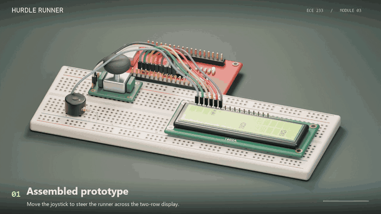
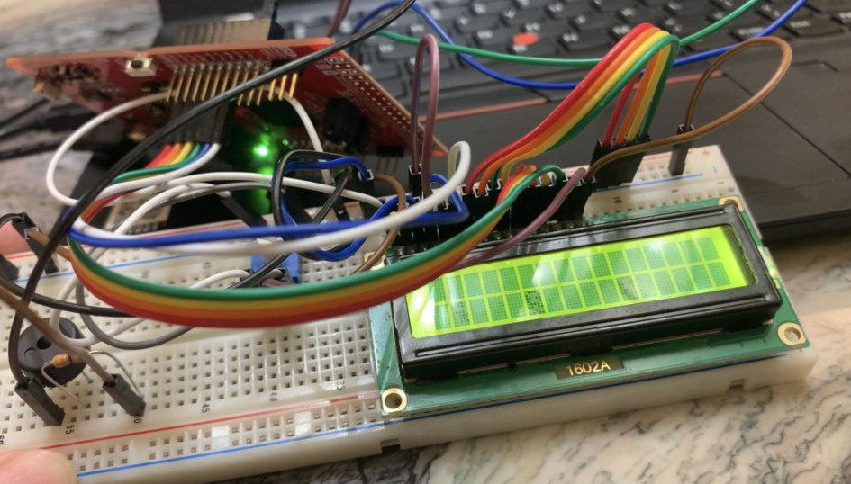

# 跨栏游戏机 · Hurdle Runner

ECE 233 · Module 3。按下摇杆跳跃，左右推动摇杆移动角色；碰撞后 LCD 显示分数。

[观看 720p 拆解动画（MP4 · 18 秒）](media/assembly.mp4) · [下载可编辑 Blender 场景](hurdle-runner.blend) · [展开态大图](media/exploded.jpg)

## 在 Blender 中查看

用 Blender 4.5.3 LTS 或兼容版本打开工程。时间轴为 1–360 帧、20 fps；按空格播放，按时间轴标记可检查对应拆解步骤。在 Outliner 中展开编号集合，选择名称带 motion 的父对象可调整整个模块的位移，子对象可单独编辑形状与材质。数字小键盘 0 可切换相机视图。工程包含材质、灯光、镜头和零件关键帧，MP4 另加了跟踪标注与中文字幕。

| 时间 | 镜头动作 |
| --- | --- |
| 0–3.7 秒 | 从组装态转动到正面，跳线束离开模块 |
| 3.7–8 秒 | 字符屏上移并侧倾，摇杆单元分离，摇杆帽露出轴杆 |
| 8–11.6 秒 | 分离蜂鸣器、电阻和控制板 |
| 11.6–18 秒 | 镜头绕行观察展开关系，各模块依次回到原位 |

## 实物对照

布局参考原技术报告的实物照片与演示视频。模型以功能模块为单位展示，板卡细节、跳线走向和拆开距离经过简化。硬件复接以原报告、电路图和板卡资料为准。

## 硬件与接口

| 部件 | 在这台游戏机中的作用 | 原项目可核对的标记 |
| --- | --- | --- |
| TI 微控制器开发板 | 采集输入、更新游戏状态、驱动外设 | 照片可见 Texas Instruments 标识；具体板号待核实 |
| 带按键的模拟摇杆 | X 轴控制左右移动；按下触发跳跃 | 源码读取 `A8`，报告将 X 轴标为 `P4_4`；按键接 `P4_7`，内部上拉、下降沿中断 |
| 1602A 字符 LCD | 两行分别容纳空中与地面位置；自定义点阵绘制角色和障碍 | `lcd.begin(16, 2)`，四位并行接口 |
| 蜂鸣器 | 按音符频率与节拍播放《铃儿响叮当》 | 独立音乐草图使用 `P3_5` 和 `tone()` |
| 面包板、跳线及调节元件 | 承载外围器件并连接信号、电源和地 | 照片可见跳线与电阻；报告的 LCD 接线图另标有对比度电位器，阻值未注明 |

**LCD 信号顺序**与原始 `LiquidCrystal` 构造函数一致。

| LCD 信号 | RS | E | D4 | D5 | D6 | D7 |
| --- | --- | --- | --- | --- | --- | --- |
| 控制板引脚 | P6_7 | P2_3 | P2_6 | P2_4 | P5_6 | P6_6 |

## 软件与游戏流程

| 原始草图 | 职责与实现 |
| --- | --- |
| [PlayerAction.ino](firmware/PlayerAction/PlayerAction.ino) | 通过 `analogRead(A8)` 读摇杆。低于 250 置后退标志，高于 800 置前进标志，按键中断置跳跃标志。250 ms 定时任务推进状态机，更新角色的列和行。 |
| [RefreshScreen.ino](firmware/RefreshScreen/RefreshScreen.ino) | 用 `LiquidCrystal` 绘制角色和两处障碍。两处障碍从不同列进入屏幕、向左移动，越界后回绕。程序比较角色与障碍坐标，未判定碰撞时加一分，碰撞时显示结束画面。 |
| [Music_JingleBells.ino](firmware/Music_JingleBells/Music_JingleBells.ino) | 音高表与时值表按相同索引读取；通过 `tone()`、延时和 `noTone()` 播放旋律。该草图有独立的 `setup()` 和 `loop()`。 |

### 工程状态

资料保留了三个原始 `.ino`。游戏部分共享角色坐标、障碍坐标和定时器类型：`PlayerAction` 提供初始化与任务函数，`RefreshScreen` 有自己的主循环；音乐例程又定义了自己的入口。所给源码中未见统一调度三者的主程序。游戏部分涉及 `OneMsTaskTimer`、`LiquidCrystal` 和支持上述 TI 引脚别名的板卡环境。仓库按模块保存源码，本次未进行固件合并、编译或上板验证。

